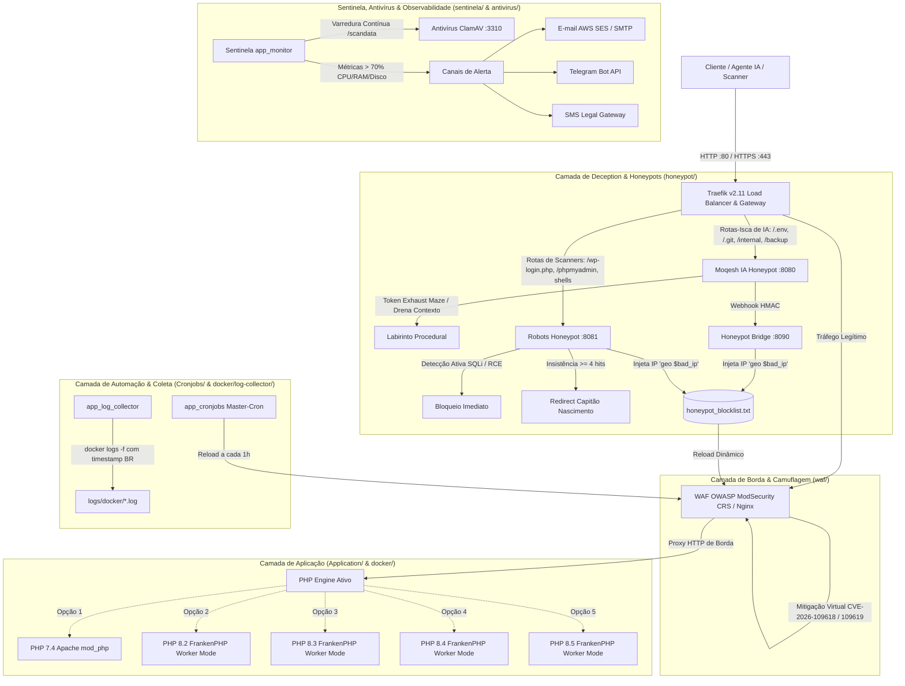

# 🛡️ Docker PHP Enterprise - Multi-Versão (7.4, 8.2, 8.3, 8.4, 8.5)

Cluster Docker de Alta Performance e Segurança Camuflada com suporte nativo a múltiplas versões do PHP, Load Balancer **Traefik v2.11**, WAF com **OWASP ModSecurity CRS**, **Honeypot para Agentes de IA (Moqesh)**, **Honeypot para Scanners/Robôs**, **FrankenPHP (Worker Mode)**, **Antivírus ClamAV** e **Monitor Sentinela** com telemetria e alertas em tempo real.

> 🇧🇷 **Localização & Fuso Horário**: Todo o ecossistema roda sob fuso de Brasília (`America/Sao_Paulo`) e locale `pt-BR.UTF-8`.

---

## 🏗️ Arquitetura e Camadas de Proteção



---

## 📁 Estrutura do Projeto

```text
├── Application/              # Código-fonte da aplicação PHP (index.php, info.php com diagnóstico completo)
├── honeypot/                 # Sistema integrado de Deception & Honeypots
│   ├── IA/                   # Honeypot especializado contra agentes de IA e pentest autônomo
│   │   ├── moqesh/           # Repositório Moqesh oficial (git clone upstream)
│   │   ├── Dockerfile.moqesh # Build customizado com fuso de Brasília e correções
│   │   ├── bridge/           # Ponte webhook HMAC para sincronização com o WAF
│   │   └── lures/            # Iscas (robots.txt com Disallow e links ocultos em PHP)
│   ├── Robots/               # Honeypot para bots, scanners e brute-force
│   │   ├── robots_honeypot.py# Servidor de iscas com Tarpit, detecção de SQLi/RCE e redirect
│   │   └── php/              # Campos honeypot invisíveis para formulários
│   ├── blocklist/            # Blocklist compartilhada lida pelo Nginx geo $bad_ip
│   └── scripts/              # Scripts de reload do WAF e validação DNSBL
├── Cronjobs/                 # Orquestrador de tarefas em segundo plano (Master-Cron)
├── docker/                   # Imagens das versões do PHP (7.4 a 8.5) e log-collector
│   └── log-collector/        # Coletor automático de stdout/stderr dos containers em logs/docker
├── load-balance/             # Configurações do Traefik v2.11 (traefik.yml, dynamic.yml)
├── antivirus/                # Configurações do ClamAV e pasta de quarentena
├── sentinela/                # Agente de telemetria, integridade e alertas
├── waf/                      # Firewall WAF (OWASP ModSecurity CRS + Nginx)
├── logs/                     # Diretório centralizado de logs
│   └── docker/               # Logs individuais de cada container e dos honeypots
└── ssl/                      # Certificados SSL/TLS (mkcert local e Let's Encrypt)
```


### 📚 Documentação Dedicada por Camada da Infraestrutura

Cada camada possui seu próprio manual técnico detalhando arquitetura, variáveis e comandos:

| Camada | Diretório | Finalidade & Tecnologias | Guia Técnico |
| :--- | :---: | :--- | :---: |
| **Borda & Load Balancer** | [`load-balance/`](load-balance/) | Traefik v2.11, terminação TLS, plugins de segurança e priorização | [📖 Ler Manual](load-balance/README.md) |
| **WAF & Firewall Web** | [`waf/`](waf/) | OWASP ModSecurity CRS, Nginx, camuflagem IIS/Cloudflare e mitigação | [📖 Ler Manual](waf/README.md) |
| **Honeypots (IA & Bots)** | [`honeypot/`](honeypot/) | Moqesh (Token Exhaust para IA) e Honeypot de Scanners com Tarpit | [📖 Ler Manual](honeypot/README.md) |
| **Aplicação & Worker** | [`Application/`](Application/) | FrankenPHP Worker Mode, roteamento dinâmico e detecção de ambiente | [📖 Ler Manual](Application/README.md) |
| **Automação & Cronjobs** | [`Cronjobs/`](Cronjobs/) | Orquestrador Master-Cron Python para execução no Docker Socket | [📖 Ler Manual](Cronjobs/README.md) |
| **Sentinela Guardian** | [`sentinela/`](sentinela/) | Monitoramento de recursos (> 70% CPU/RAM) e alertas Telegram/SMS | [📖 Ler Manual](sentinela/README.md) |
| **Antivírus & Quarentena** | [`antivirus/`](antivirus/) | ClamAV Daemon (:3310), freshclam e quarentena de ameaças | [📖 Ler Manual](antivirus/README.md) |
| **Certificados SSL/TLS** | [`ssl/`](ssl/) | Geração local (mkcert/OpenSSL) e produção automática (Let's Encrypt) | [📖 Ler Manual](ssl/README.md) |

---

## 🛡️ Destaques da Infraestrutura

1. **Honeypot para Agentes de IA (Moqesh)**:
   - Defesa de última geração contra agentes autônomos de IA e ferramentas de pentest baseadas em LLM.
   - Ativado sob rotas-isca (`/.env`, `/.git`, `/.aws`, `/internal`, `/backup`, `/staging`, `/api-internal`).
   - Servindo um **Labirinto Token Exhaust**: consome as janelas de contexto e cotas de tokens do atacante gerando respostas coerentes e infinitas.
   - O Moqesh pontua o comportamento da sessão; caso ultrapasse o threshold ou tente reusar honeytokens, aciona a **Honeypot Bridge via webhook HMAC**, bloqueando o IP no cluster inteiro.

2. **Honeypot para Robôs e Scanners (Robots)**:
   - Focado em varreduras automáticas de vulnerabilidades e ferramentas genéricas (`sqlmap`, `nmap`, `nikto`, `masscan`, etc.).
   - Iscas ativas em `/wp-login.php`, `/wp-admin`, `xmlrpc.php`, `/phpmyadmin`, `/pma`, `/adminer`, `/shell.php`, etc.
   - **Detecção Ativa de Ataques**: Analisa requisições contra padrões conhecidos de SQL Injection, RCE/Shell Injection e leitura de arquivos sensíveis.
   - **Tarpit Adaptativo**: Prende a conexão do bot enviando dados byte a byte para esgotar recursos do invasor.
   - **Redirecionamento Punitivo (Capitão Nascimento)**: Se o atacante insistir nas requisições (`hits >= 4`), é redirecionado via HTTP 302 direto para o vídeo do Capitão Nascimento (`https://www.yout-ube.com/watch?v=TwIsz1BO3Dc`).

3. **Traefik v2.11 (Gateway e Roteador Prioritário)**:
   - Terminação TLS nativa com HTTP/HTTPS nas portas 80 e 443.
   - Roteamento prioritário (`priority: 9000`) para interceptar rotas de honeypot antes que atinjam o PHP ou o WAF.
   - Headers camuflados simulando `Microsoft-IIS/10.0` e `ASP.NET`.

4. **WAF OWASP ModSecurity CRS / Nginx**:
   - Camada de mitigação virtual e bloqueio imediato com base na diretiva `geo $bad_ip` alimentada pelos honeypots.
   - Regras contra OWASP Top 10 e mitigação para `CVE-2026-109618` e `CVE-2026-109619`.

5. **Auditoria em Tempo Real (`http://localhost/info.php`)**:
   - Painel integrado exibindo o status operacional de **todos os 8 serviços principais da stack**:
     - WAF (ModSecurity CRS)
     - Antivírus (ClamAV)
     - Honeypot IA (Moqesh)
     - Honeypot Robots & Scanners
     - Honeypot Bridge (WAF Sync)
     - Traefik Load Balancer
     - Sentinela Guardian
     - Camada Criptográfica SSL/TLS


5. **Blindagem do Kernel Linux (Mitigação de CVEs Críticas)**:
   - O instalador (`install.ps1` e `install.sh`) e o `docker-compose.yml` possuem rotinas automáticas de contenção para:
     - **CVE-2026-74580 (Vghost)**: Bloqueio do módulo `vhost_net`/`vhost_vsock` e isolamento total de nós `/dev/vhost-*`.
     - **CVE-2026-46300 (Fragnesia)**: Bloqueio dos módulos IPsec `esp4`/`esp6` e drop de capabilities de rede (`cap_drop: ALL`).
     - **CVE-2026-31431 (Copy Fail)**: Desativação do módulo `algif_aead` e imposição da diretiva `no-new-privileges:true` em todos os containers PHP e Honeypots.
     - **CVE-2026-98432 (TCP UAF RCE)**: Desativação automática de Multipath TCP (`net.mptcp.enabled = 0`) no host via sysctl e terminação de conexões pelo Traefik na borda.
---

## 🚀 Instalação Rápida e Gerenciador

O projeto conta com instaladores automatizados para todos os sistemas operacionais:

### No Windows:
Dê dois cliques em `install.bat` ou execute via PowerShell:
```powershell
.\install.ps1
```

### No Linux / macOS:
```bash
chmod +x install.sh
./install.sh
```

### Opções do Menu Interativo:
* **[1] a [5]** Ativar versão específica do PHP (7.4, 8.2, 8.3, 8.4 ou 8.5) junto com Traefik, WAF, Cronjobs, Log Collector e Honeypots.
* **[6]** Subir Cluster Completo (todas as versões ativas).
* **[7]** Subir Sentinela de Recursos, Antivírus ClamAV & Cronjobs.
* **[8]** Disparar Varredura Manual Imediata do Antivírus.
* **[9]** Gerar / Regenerar Certificados SSL Locais e Let's Encrypt.
* **[10]** Configurar variáveis do `.env`.
* **[11]** Parar todos os containers.

---

## 🌐 Acesso aos Serviços

* **Aplicação Principal**: `http://localhost/` ou `https://localhost/`
* **Auditoria de Serviços**: `http://localhost/info.php` ou `https://localhost/info.php`
* **Dashboard Traefik**: `https://localhost/load-balance/`
* **Dashboard Moqesh IA**: `https://honeypot.localhost/`