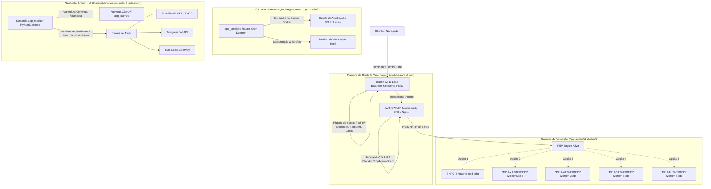

# 🛡️ Docker PHP Enterprise - Multi-Versão (7.4, 8.2, 8.3, 8.4, 8.5)

Cluster Docker de Alta Performance e Segurança Camuflada com suporte nativo a múltiplas versões do PHP, Load Balancer **Traefik v2.11**, WAF com **OWASP ModSecurity CRS / Coraza**, **FrankenPHP (Worker Mode)**, **Antivírus ClamAV** e **Monitor Sentinela** com alertas em tempo real.

---

## 🏛️ Arquitetura e Camadas de Proteção



---

## 📁 Estrutura do Projeto

O projeto é organizado modularmente por responsabilidade:

```text
├── Application/              # Código-fonte da aplicação PHP (index.php, info.php, etc.)
├── Cronjobs/                 # Orquestrador de tarefas e scripts em segundo plano
│   ├── Dockerfile            # Container dedicado do orquestrador Master-Cron
│   ├── Jobs/tasks/           # Definições das tarefas agendadas (tasks.json)
│   ├── Master-Cron/          # Daemon orquestrador Python
│   └── Scripts/              # Scripts utilitários de manutenção
├── docker/                   # Definições Dockerfile e configs específicas das versões PHP (7.4 a 8.5)
├── load-balance/             # Configurações do Traefik (traefik.yml, dynamic.yml)
├── antivirus/                # Configurações do ClamAV e pasta de quarentena
│   └── quarentena/           # Arquivos infectados isolados
├── sentinela/                # Agente de monitoramento de recursos e alertas
│   ├── docker/               # Dockerfile do serviço sentinela
│   ├── emails/               # Templates e envio de e-mails
│   └── monitor/              # Daemon de telemetria
├── waf/                      # Firewall de Aplicações Web (OWASP ModSecurity CRS + Nginx)
│   ├── config/               # Overrides e regras customizadas
│   ├── scripts/              # Scripts de atualização de blocklists e reputação
│   └── templates/            # Templates Nginx com camuflagem IIS/Cloudflare
├── logs/                     # Diretório centralizado de persistência de logs
│   ├── traefik/              # Logs de acesso e diagnóstico do Load Balancer
│   ├── waf/                  # Logs de bloqueio, acesso e auditoria do WAF
│   ├── antivirus/            # Logs do ClamAV (clamd, freshclam)
│   └── sentinela/            # Logs e históricos de alertas do Sentinela
└── ssl/                      # Certificados SSL/TLS (locais mkcert e Let's Encrypt)
    ├── certs/                # Certificados locais (.crt, .key)
    └── letsencrypt/          # Armazenamento acme.json para produção
```

---

## 🚀 Destaques da Infraestrutura

1. **Traefik v2.11 (Gateway Único :80 e :443)**:
   - Terminação TLS nativa com suporte dinâmico a certificados locais (`mkcert` em `ssl/certs`) e certificados de produção automáticos via **Let's Encrypt** (`ssl/letsencrypt/acme.json`).
   - Plugins oficiais ativados:
     - `traefik-real-ip`: Preserva e valida o IP real do cliente atrás de proxies/Cloudflare.
     - `fail2ban`: Bloqueio temporário de força bruta na borda.
     - `geoblock`: Bloqueio geográfico de países de alto risco.
     - `torblock`: Bloqueio em tempo real de nós de saída da rede Tor.
     - `bad-bot-blocker`: Bloqueio antecipado de ferramentas de ataque (sqlmap, nikto, dirbuster, scrapers abusivos).
     - `validate-headers`: Sanitização estrita de requisições HTTP (bloqueia requisições sem `User-Agent` ou corrompidas).
     - `corspreflight`: Resposta `204 No Content` automática na borda para preflights `OPTIONS` (acelera SPAs e mobile).
     - `staticresponse`: Endpoints `/healthz` e `/ping` respondem `200 OK` instantaneamente na borda com headers camuflados.
     - `cache`: Cache de respostas HTTP na borda.
     - `requestid`, `error-pages`, `bandwidth-limiter`, `query-modification`, `redirect-location`, `rewrite-body`.
   - **Dashboard Protegido**: Interface administrativa acessível via `https://localhost/load-balance/` protegida por HTTP Basic Auth configurável no `.env`.

2. **WAF OWASP ModSecurity CRS / Nginx (Muralha Enterprise)**:
   - **Camuflagem Estrita**: Responde com headers idênticos ao `Microsoft-IIS/10.0` (`X-Powered-By: ASP.NET`, `X-AspNet-Version: 4.0.30319`) e fingerprinting do Cloudflare (`cf-ray`, `cf-cache-status`), enganando scanners e bots de varredura.
   - **Mitigação de Vulnerabilidades**: Regras virtuais de bloqueio para vetores de ataque `CVE-2026-109618` e `CVE-2026-109619`.
   - **Proteção Completa OWASP Top 10**: Bloqueio ativo de SQL Injection, XSS, CSRF, PHP Object Injection e LFI/SSRF.
   - **Honeypots com Gzip Bomb**: Armadilhas para scanners de rotas administrativas que entregam payloads GZIP de descompressão massiva.
   - **Buraco Negro (Loop 301)**: Scanners de arquivos sensíveis (`.env`, `.sql`, `.bak`, `.conf`, `.sh`) caem em loops infinitos.
   - **Reputação DNSBL Global em Tempo Real**: Consulta ativa contra bases de inteligência (Spamhaus, Barracuda, DroneBL, CBL, SORBS, SpamCop).
   - **Bloqueio Maciço Anti-OSINT & Agentes de IA**: Bloqueio de bots como GPTBot, ClaudeBot, Perplexity, Bytespider, Shodan, Censys, etc.

3. **Orquestrador de Cronjobs (`app_cronjobs`)**:
   - Serviço conteinerizado autônomo com acesso controlado ao Docker Socket.
   - Executa rotinas automáticas declaradas em `Cronjobs/Jobs/tasks/tasks.json` diretamente nos contêineres alvos (ex: atualização de listas de IP maliciosos no WAF, limpeza periódica de quarentena, etc.).

4. **FrankenPHP (Worker Mode & Caddy Engine)**:
   - Suporte a Worker Mode de alto rendimento (`worker /var/www/html/frankenphp-worker.php 4`), mantendo o ciclo do interpretador aquecido em memória RAM.
   - 20+ extensões essenciais pré-compiladas: `pdo_mysql`, `pdo_pgsql`, `pdo_sqlsrv`, `pdo_firebird`, `interbase`, `redis`, `gd`, `imagick`, `intl`, `opcache`, `zip`, `zstd`, `bcmath`, `soap`, `sockets`, etc.
   - Ferramentas de QA globais: `composer`, `phpunit`, `pest`, `phpstan`, `psalm`, `infection`, `browscap`.

5. **Sentinela de Recursos & Antivírus ClamAV**:
   - Daemon em segundo plano monitorando uso de CPU, RAM e Disco a cada 60 segundos.
   - Alertas instantâneos caso o uso ultrapasse 70% ou caso o ClamAV detecte arquivos infectados em `antivirus/quarentena/`.
   - Disparo simultâneo via **Amazon SES**, **Telegram Bot** e **SMS Legal**.

---

## 💻 Requisitos Mínimos de Sistema

| Recurso | Mínimo Obrigatório | Recomendado | Finalidade |
| :--- | :---: | :---: | :--- |
| **Memória RAM (Host)** | **12 GB** | **16 GB** | O ClamAV aloca ~2GB para as assinaturas virais em memória + workers do FrankenPHP. |
| **Memória RAM (Docker)** | **4 GB** | **6 GB** | Limite atribuído ao engine Docker Desktop / WSL2. |
| **Espaço Livre em Disco** | **15 GB** | **30 GB** | Imagens Docker, bases de assinaturas do ClamAV e logs. |
| **Processador** | 2 Cores | 4 Cores ou superior | Compilação de extensões e workers CGO. |

---

## 🛠️ Instalação Rápida e Gerenciador

O projeto conta com instaladores automatizados para todos os sistemas operacionais, com **auto-instalação de dependências** (Docker Desktop, Git, mkcert caso não estejam presentes na máquina):

### No Windows:
Dê dois cliques em `install.bat` ou abra o PowerShell:
```powershell
.\install.ps1
```

### No Linux / macOS:
```bash
chmod +x install.sh
./install.sh
```

### Opções do Menu Interativo:
* **[1]** Ativar PHP 7.4 (Apache mod_php + WAF + Traefik na porta 80/443)
* **[2]** Ativar PHP 8.2 (FrankenPHP Worker + WAF + Traefik na porta 80/443)
* **[3]** Ativar PHP 8.3 (FrankenPHP Worker + WAF + Traefik na porta 80/443)
* **[4]** Ativar PHP 8.4 (FrankenPHP Worker + WAF + Traefik na porta 80/443)
* **[5]** Ativar PHP 8.5 (FrankenPHP Worker + WAF + Traefik na porta 80/443)
* **[6]** Subir Cluster Completo (Todas as versões ativas roteadas via Traefik)
* **[7]** Subir Sentinela de Recursos, Antivírus ClamAV & Cronjobs
* **[8]** Disparar Varredura Manual Imediata do Antivírus
* **[9]** Gerar / Regenerar Certificados SSL Locais e Let's Encrypt
* **[10]** Configurar variáveis do `.env`
* **[11]** Parar todos os containers

---

## 🔒 Certificados SSL e Acesso aos Serviços

* **Acesso HTTP (Porta 80)**: `http://localhost/info.php` (com redirecionamento automático para HTTPS)
* **Acesso HTTPS Seguro (Porta 443)**: `https://localhost/info.php`
* **Dashboard Traefik Protegido**: `https://localhost/load-balance/` ou `https://localhost/dashboard/`
  - *Autenticação*: Credenciais definidas no arquivo `.env` (`TRAEFIK_DASHBOARD_USER` / `TRAEFIK_DASHBOARD_PASSWORD`).
* **Logs Centralizados**: Persistidos em subpastas dedicadas em `logs/` (`traefik/`, `waf/`, `antivirus/`, `sentinela/`).

---

## 🌐 Guia de Implantação em Produção (VPS ou Servidor Dedicado)

Este cluster foi desenhado para rodar nativamente em qualquer servidor Linux (Ubuntu 22.04 / 24.04 LTS, Debian 12, Rocky Linux, AlmaLinux ou RHEL) com desempenho de nível empresarial e segurança de borda.

### 1. Preparação da Máquina (Host)

#### 1.1 Configuração de SWAP (Essencial para VPSs com 4GB a 8GB de RAM)
O ClamAV aloca ~1.5 GB a 2 GB para manter as bases de assinaturas de vírus aquecidas em memória, e o FrankenPHP aloca memória para os workers Caddy. Crie 4GB a 8GB de Swap para evitar incidentes de Out-Of-Memory (OOM):
```bash
# Criar arquivo swap de 4GB
sudo fallocate -l 4G /swapfile
sudo chmod 600 /swapfile
sudo mkswap /swapfile
sudo swapon /swapfile

# Persistir no fstab
echo '/swapfile none swap sw 0 0' | sudo tee -a /etc/fstab

# Ajustar agressividade do Swap
sudo sysctl vm.swappiness=10
echo 'vm.swappiness=10' | sudo tee -a /etc/sysctl.conf
```

#### 1.2 Ajuste dos Limites do Kernel do Linux
O Traefik e o FrankenPHP processam milhares de conexões simultâneas. Ajuste os descritores de arquivos e memória virtual do sistema:
```bash
sudo bash -c 'cat <<EOF >> /etc/sysctl.d/99-enterprise-cluster.conf
fs.file-max = 2097152
net.core.somaxconn = 65535
net.ipv4.tcp_max_syn_backlog = 8192
vm.max_map_count = 262144
EOF'
sudo sysctl --system
```

---

### 2. Firewall do Servidor (UFW / iptables)

Mantenha apenas as portas estritamente públicas abertas. O WAF, o FrankenPHP e o ClamAV rodam de forma privada dentro da rede interna do Docker (`php_enterprise_network`):

```bash
# Permitir SSH (ajuste a porta caso use uma porta customizada)
sudo ufw allow 22/tcp

# Portas públicas do Traefik Load Balancer
sudo ufw allow 80/tcp
sudo ufw allow 443/tcp

# Ativar o firewall
sudo ufw enable
sudo ufw status
```

> [!IMPORTANT]
> **Nunca abra as portas internas no firewall da VPS** (ex: 8080, 8083, 3310, 7357). O Traefik gerencia todo o roteamento internamente através das redes do Docker.

---

### 3. Configuração de DNS e Domínios

No seu registrador de domínio ou provedor de DNS (ex: Cloudflare, Route53, Registro.br), aponte os registros tipo **A** para o endereço IPv4 público da sua VPS:

| Tipo | Nome | Conteúdo / Destino | TTL |
| :---: | :---: | :---: | :---: |
| **A** | `meudominio.com` | `IP_PUBLICO_DA_VPS` | Auto / 300 |
| **A** | `*.meudominio.com` | `IP_PUBLICO_DA_VPS` | Auto / 300 |

> [!TIP]
> **Uso com Cloudflare**: Se optar por usar o proxy da Cloudflare (nuvem laranja), configure o modo SSL/TLS como **Full (Strict)**. O plugin `traefik-real-ip` já está configurado no nosso `dynamic.yml` para extrair e confiar automaticamente nos IPs das requisições vindas dos edge nodes da Cloudflare.

---

### 4. Configuração das Variáveis de Ambiente (`.env`)

No diretório do projeto na VPS, edite o arquivo `.env`:

```bash
# 1. Defina o ambiente de produção
ENVIRONMENT=production

# 2. Defina os domínios atendidos
DOMAINS=meudominio.com,www.meudominio.com,app.meudominio.com

# 3. Certificados Let's Encrypt Automáticos
LETSENCRYPT_EMAIL=admin@meudominio.com
LETSENCRYPT_ENABLED=true

# 4. Credenciais Fortes para o Traefik Dashboard (https://meudominio.com/load-balance/)
TRAEFIK_DASHBOARD_USER=admin_seguro
TRAEFIK_DASHBOARD_PASSWORD=SuaSenhaForteSuperSegura2026!

# 5. Configuração do Sentinela de Alertas (Telegram e E-mail SES/SMTP)
TELEGRAM_BOT_TOKEN=seu_bot_token_aqui
TELEGRAM_CHAT_ID=seu_chat_id_aqui
SMTP_HOST=email-smtp.us-east-1.amazonaws.com
SMTP_PORT=587
SMTP_USER=seu_usuario_smtp
SMTP_PASS=sua_senha_smtp
SMTP_FROM=alerts@meudominio.com
ALERT_EMAILS=devops@meudominio.com,cto@meudominio.com
```

---

### 5. Permissões de Pastas no Linux

Certifique-se de que o Docker tenha as permissões corretas para gravação de logs, certificados e quarentena:

```bash
# Garantir permissões de escrita para logs e certificados
chmod -R 755 logs/ antivirus/quarentena/ Application/
chmod 600 ssl/letsencrypt/acme.json 2>/dev/null || true
```

---

### 6. Inicialização em Produção

Execute o script de instalação ou suba diretamente via Docker Compose no modo desacoplado (`-d`):

```bash
# Opção 1: Pelo gerenciador interativo
./install.sh

# Opção 2: Subida direta da versão desejada (exemplo: PHP 8.3 com tudo ativo)
docker compose -p php83 up -d --build
```

### 7. Validação de Saúde dos Serviços (Healthcheck)

Após a subida, valide os contêineres e a resolução de borda:

```bash
# 1. Verificar contêineres ativos
docker compose -p php83 ps

# 2. Testar resposta estática ultra-leve de borda
curl -I https://meudominio.com/healthz

# 3. Testar a aplicação PHP rodando atrás do WAF
curl -I https://meudominio.com/info.php

# 4. Acessar o Dashboard Administrativo Protegido
# URL: https://meudominio.com/load-balance/
```

---

### 8. Manutenção e Ciclo de Vida em Produção

* **Atualização de Código da Aplicação**:
  Coloque seu código em `Application/`. Ele é montado em tempo real nos contêineres FrankenPHP/Apache. Se usar Composer em produção:
  ```bash
  docker compose -p php83 exec app_php83 composer install --no-dev --optimize-autoloader
  ```

* **Visualização Centralizada de Logs**:
  Todos os eventos de segurança, acessos e auditoria são persistidos e categorizados:
  ```bash
  # Ver bloqueios do WAF em tempo real
  tail -f logs/waf/error.log

  # Ver acessos no Traefik Load Balancer
  tail -f logs/traefik/access.log

  # Ver auditoria de integridade do Sentinela
  tail -f logs/sentinela/*.log
  ```

* **Reinicialização Zero-Downtime**:
  Para recarregar configurações do WAF ou Traefik sem derrubar conexões de clientes:
  ```bash
  docker compose -p php83 restart app_waf_php83 app_traefik_loadbalance
  ```
